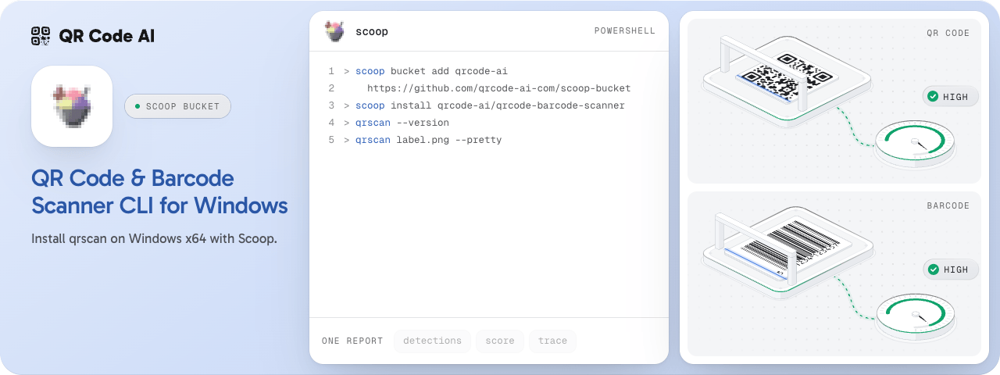

<p align="center">
  <a href="https://github.com/qrcode-ai-com/qrcode-barcode-scanner-rust">
    <picture>
      <source media="(prefers-color-scheme: dark)" srcset="https://raw.githubusercontent.com/qrcode-ai-com/scoop-bucket/main/assets/banner-dark.gif?v=489226253705">
      
    </picture>
  </a>
</p>

# QR Code AI Scoop bucket

<!-- qrcode-ai-readme-actions:v2 -->

### Ask AI

[](https://chatgpt.com/?q=Help%20me%20understand%20QR%20Code%20AI%20Scoop%20bucket%20for%20QR%20Code%20%26%20Barcode%20Scanner%2C%20the%20open-source%20scanner.%20Published%20Scoop%20bucket%20for%20qrscan%200.11.0%3B%20source%20documentation%20does%20not%20publish%20a%20new%20binary.%20Provided%20README%20context%20%28verify%20against%20the%20sources%29%3A%20Use%20this%20Scoop%20bucket%20to%20install%20qrscan%20on%20Windows%20x64%20from%20the%20checksum-pinned%20upstream%20release%20archive.%20The%20command%20reads%20saved%20image%20files%20and%20returns%20structured%20scanner%20output%3B%20it%20does%20not%20need%20a%20web%20account.%20Keep%20image%20paths%20with%20spaces%20quoted%20and%20retain%20the%20full%20barcode%20string%2C%20including%20leading%20zeroes%2C%20before%20passing%20the%20result%20into%20another%20script.%20Scoop%20manages%20the%20executable%20and%20its%20removal.%20Read%20the%20public%20documentation%20below.%20Explain%20what%20this%20destination%20does%2C%20its%20documented%20installation%20or%20access%20steps%2C%20a%20minimal%20example%20if%20supported%2C%20prerequisites%2C%20limitations%20and%20license.%20Distinguish%20published%20packages%20from%20working%20source%20and%20preparation.%20Cite%20your%20sources%3B%20if%20a%20page%20is%20unavailable%20or%20a%20fact%20cannot%20be%20checked%2C%20say%20so.%20Do%20not%20invent%20installation%20commands%2C%20benchmark%20results%20or%20comparisons.%20Answer%20in%20my%20language.%20Public%20sources%3A%20https%3A%2F%2Fgithub.com%2Fqrcode-ai-com%2Fscoop-bucket%2Fblob%2Fmain%2FREADME.md%20https%3A%2F%2Fqrcode-ai.com%2Fen-US%2Fqr-code-scanner%20https%3A%2F%2Fqrcode-ai.com%2Fen-US%2Fbarcode-scanner%20https%3A%2F%2Fqrcode-ai.com%2Fen-US%2Fqr-code-scanner%2Fcli%20https%3A%2F%2Fqrcode-ai.com%2Fen-US%2Fbarcode-scanner%2Fcli%20https%3A%2F%2Fqrcode-ai.com%2Fen-US%2Fqr-code-generator%20https%3A%2F%2Fqrcode-ai.com%2Fen-US%2Fbarcode-generator)
[](https://claude.ai/new?q=Help%20me%20understand%20QR%20Code%20AI%20Scoop%20bucket%20for%20QR%20Code%20%26%20Barcode%20Scanner%2C%20the%20open-source%20scanner.%20Published%20Scoop%20bucket%20for%20qrscan%200.11.0%3B%20source%20documentation%20does%20not%20publish%20a%20new%20binary.%20Provided%20README%20context%20%28verify%20against%20the%20sources%29%3A%20Use%20this%20Scoop%20bucket%20to%20install%20qrscan%20on%20Windows%20x64%20from%20the%20checksum-pinned%20upstream%20release%20archive.%20The%20command%20reads%20saved%20image%20files%20and%20returns%20structured%20scanner%20output%3B%20it%20does%20not%20need%20a%20web%20account.%20Keep%20image%20paths%20with%20spaces%20quoted%20and%20retain%20the%20full%20barcode%20string%2C%20including%20leading%20zeroes%2C%20before%20passing%20the%20result%20into%20another%20script.%20Scoop%20manages%20the%20executable%20and%20its%20removal.%20Read%20the%20public%20documentation%20below.%20Explain%20what%20this%20destination%20does%2C%20its%20documented%20installation%20or%20access%20steps%2C%20a%20minimal%20example%20if%20supported%2C%20prerequisites%2C%20limitations%20and%20license.%20Distinguish%20published%20packages%20from%20working%20source%20and%20preparation.%20Cite%20your%20sources%3B%20if%20a%20page%20is%20unavailable%20or%20a%20fact%20cannot%20be%20checked%2C%20say%20so.%20Do%20not%20invent%20installation%20commands%2C%20benchmark%20results%20or%20comparisons.%20Answer%20in%20my%20language.%20Public%20sources%3A%20https%3A%2F%2Fgithub.com%2Fqrcode-ai-com%2Fscoop-bucket%2Fblob%2Fmain%2FREADME.md%20https%3A%2F%2Fqrcode-ai.com%2Fen-US%2Fqr-code-scanner%20https%3A%2F%2Fqrcode-ai.com%2Fen-US%2Fbarcode-scanner%20https%3A%2F%2Fqrcode-ai.com%2Fen-US%2Fqr-code-scanner%2Fcli%20https%3A%2F%2Fqrcode-ai.com%2Fen-US%2Fbarcode-scanner%2Fcli%20https%3A%2F%2Fqrcode-ai.com%2Fen-US%2Fqr-code-generator%20https%3A%2F%2Fqrcode-ai.com%2Fen-US%2Fbarcode-generator)
[](https://gemini.google.com/)
[](https://grok.com/?q=Help%20me%20understand%20QR%20Code%20AI%20Scoop%20bucket%20for%20QR%20Code%20%26%20Barcode%20Scanner%2C%20the%20open-source%20scanner.%20Published%20Scoop%20bucket%20for%20qrscan%200.11.0%3B%20source%20documentation%20does%20not%20publish%20a%20new%20binary.%20Provided%20README%20context%20%28verify%20against%20the%20sources%29%3A%20Use%20this%20Scoop%20bucket%20to%20install%20qrscan%20on%20Windows%20x64%20from%20the%20checksum-pinned%20upstream%20release%20archive.%20The%20command%20reads%20saved%20image%20files%20and%20returns%20structured%20scanner%20output%3B%20it%20does%20not%20need%20a%20web%20account.%20Keep%20image%20paths%20with%20spaces%20quoted%20and%20retain%20the%20full%20barcode%20string%2C%20including%20leading%20zeroes%2C%20before%20passing%20the%20result%20into%20another%20script.%20Scoop%20manages%20the%20executable%20and%20its%20removal.%20Read%20the%20public%20documentation%20below.%20Explain%20what%20this%20destination%20does%2C%20its%20documented%20installation%20or%20access%20steps%2C%20a%20minimal%20example%20if%20supported%2C%20prerequisites%2C%20limitations%20and%20license.%20Distinguish%20published%20packages%20from%20working%20source%20and%20preparation.%20Cite%20your%20sources%3B%20if%20a%20page%20is%20unavailable%20or%20a%20fact%20cannot%20be%20checked%2C%20say%20so.%20Do%20not%20invent%20installation%20commands%2C%20benchmark%20results%20or%20comparisons.%20Answer%20in%20my%20language.%20Public%20sources%3A%20https%3A%2F%2Fgithub.com%2Fqrcode-ai-com%2Fscoop-bucket%2Fblob%2Fmain%2FREADME.md%20https%3A%2F%2Fqrcode-ai.com%2Fen-US%2Fqr-code-scanner%20https%3A%2F%2Fqrcode-ai.com%2Fen-US%2Fbarcode-scanner%20https%3A%2F%2Fqrcode-ai.com%2Fen-US%2Fqr-code-scanner%2Fcli%20https%3A%2F%2Fqrcode-ai.com%2Fen-US%2Fbarcode-scanner%2Fcli%20https%3A%2F%2Fqrcode-ai.com%2Fen-US%2Fqr-code-generator%20https%3A%2F%2Fqrcode-ai.com%2Fen-US%2Fbarcode-generator)
[](https://www.perplexity.ai/?q=Help%20me%20understand%20QR%20Code%20AI%20Scoop%20bucket%20for%20QR%20Code%20%26%20Barcode%20Scanner%2C%20the%20open-source%20scanner.%20Published%20Scoop%20bucket%20for%20qrscan%200.11.0%3B%20source%20documentation%20does%20not%20publish%20a%20new%20binary.%20Provided%20README%20context%20%28verify%20against%20the%20sources%29%3A%20Use%20this%20Scoop%20bucket%20to%20install%20qrscan%20on%20Windows%20x64%20from%20the%20checksum-pinned%20upstream%20release%20archive.%20The%20command%20reads%20saved%20image%20files%20and%20returns%20structured%20scanner%20output%3B%20it%20does%20not%20need%20a%20web%20account.%20Keep%20image%20paths%20with%20spaces%20quoted%20and%20retain%20the%20full%20barcode%20string%2C%20including%20leading%20zeroes%2C%20before%20passing%20the%20result%20into%20another%20script.%20Scoop%20manages%20the%20executable%20and%20its%20removal.%20Read%20the%20public%20documentation%20below.%20Explain%20what%20this%20destination%20does%2C%20its%20documented%20installation%20or%20access%20steps%2C%20a%20minimal%20example%20if%20supported%2C%20prerequisites%2C%20limitations%20and%20license.%20Distinguish%20published%20packages%20from%20working%20source%20and%20preparation.%20Cite%20your%20sources%3B%20if%20a%20page%20is%20unavailable%20or%20a%20fact%20cannot%20be%20checked%2C%20say%20so.%20Do%20not%20invent%20installation%20commands%2C%20benchmark%20results%20or%20comparisons.%20Answer%20in%20my%20language.%20Public%20sources%3A%20https%3A%2F%2Fgithub.com%2Fqrcode-ai-com%2Fscoop-bucket%2Fblob%2Fmain%2FREADME.md%20https%3A%2F%2Fqrcode-ai.com%2Fen-US%2Fqr-code-scanner%20https%3A%2F%2Fqrcode-ai.com%2Fen-US%2Fbarcode-scanner%20https%3A%2F%2Fqrcode-ai.com%2Fen-US%2Fqr-code-scanner%2Fcli%20https%3A%2F%2Fqrcode-ai.com%2Fen-US%2Fbarcode-scanner%2Fcli%20https%3A%2F%2Fqrcode-ai.com%2Fen-US%2Fqr-code-generator%20https%3A%2F%2Fqrcode-ai.com%2Fen-US%2Fbarcode-generator)
[](https://copilot.com/)
[](https://chat.deepseek.com/)
[](https://www.meta.ai/)
[](https://qwen.ai/)

Choose an AI assistant to explain this destination using its public sources. Gemini opens gemini.google.com. Gemini, Copilot, DeepSeek, Meta AI and Qwen require pasting the prompt below; the other links include it in their URL. Sign-in or a manual paste may still be required. Check the answer against the documentation.

<details>
<summary>Copy the plain-text prompt</summary>

Use the code block's copy control, or select its complete text, then paste it into your assistant.

```text
Help me understand QR Code AI Scoop bucket for QR Code & Barcode Scanner, the open-source scanner. Published Scoop bucket for qrscan 0.11.0; source documentation does not publish a new binary. Provided README context (verify against the sources): Use this Scoop bucket to install qrscan on Windows x64 from the checksum-pinned upstream release archive. The command reads saved image files and returns structured scanner output; it does not need a web account. Keep image paths with spaces quoted and retain the full barcode string, including leading zeroes, before passing the result into another script. Scoop manages the executable and its removal. Read the public documentation below. Explain what this destination does, its documented installation or access steps, a minimal example if supported, prerequisites, limitations and license. Distinguish published packages from working source and preparation. Cite your sources; if a page is unavailable or a fact cannot be checked, say so. Do not invent installation commands, benchmark results or comparisons. Answer in my language. Public sources: https://github.com/qrcode-ai-com/scoop-bucket/blob/main/README.md https://qrcode-ai.com/en-US/qr-code-scanner https://qrcode-ai.com/en-US/barcode-scanner https://qrcode-ai.com/en-US/qr-code-scanner/cli https://qrcode-ai.com/en-US/barcode-scanner/cli https://qrcode-ai.com/en-US/qr-code-generator https://qrcode-ai.com/en-US/barcode-generator
```

</details>

<!-- /qrcode-ai-readme-actions:v2 -->

Use this Scoop bucket to install qrscan on Windows x64 from the checksum-pinned upstream release archive. The command reads saved image files and returns structured scanner output; it does not need a web account. Keep image paths with spaces quoted and retain the full barcode string, including leading zeroes, before passing the result into another script. Scoop manages the executable and its removal.

The [QR code scanner](https://qrcode-ai.com/en-US/qr-code-scanner) and [barcode scanner](https://qrcode-ai.com/en-US/barcode-scanner) are the product’s browser scanning entry points. The [QR code scanner guide for the command-line](https://qrcode-ai.com/en-US/qr-code-scanner/cli) and [barcode scanner guide for the command-line](https://qrcode-ai.com/en-US/barcode-scanner/cli) are the corresponding integration routes. If those product pages are unavailable, use the installation and report instructions below.

To prepare a known input, create a QR image with the [QR code generator](https://qrcode-ai.com/en-US/qr-code-generator) or a barcode label with the [barcode generator](https://qrcode-ai.com/en-US/barcode-generator). Retain the original payload with the image so that a test can compare the complete decoded value with its expected text.

Install `qrscan`, the [QR Code AI](https://qrcode-ai.com/en-US/qr-code-scanner/cli) command-line scanner, with Scoop on Windows x64. It decodes QR codes, barcodes and supported 2D codes from local image files. The scanner returns decoded data as JSON by default and works without a web account.

## Install and scan

Install [Scoop](https://scoop.sh/) and make sure `git` is on your PATH. Run the following commands in PowerShell.

```powershell
scoop bucket add qrcode-ai https://github.com/qrcode-ai-com/scoop-bucket.git
scoop install qrcode-ai/qrcode-barcode-scanner
qrscan --version
qrscan '.\my label.png' --profile full
```

Replace `my label.png` with your image.

## Try a QR code and Code 128 in one image

```powershell
Invoke-WebRequest -Uri 'https://raw.githubusercontent.com/qrcode-ai-com/qrcode-barcode-scanner-rust/v0.11.0/fixtures/symbology/mixed-code128-qr.png' -OutFile 'mixed-codes.png'
qrscan .\mixed-codes.png --profile fast
```

The JSON `detections` includes the QR URL and Code 128 value `STOCK-4827`.

The same image, with each code outlined where the engine measured it:

<p align="center">
  <a href="https://github.com/qrcode-ai-com/qrcode-barcode-scanner-rust#examples">
    <picture>
      <source media="(prefers-color-scheme: dark)" srcset="https://raw.githubusercontent.com/qrcode-ai-com/qrcode-barcode-scanner-rust/main/docs/assets/brand/examples-mixed-dark.png?v=385593c1c18d">
      
    </picture>
  </a>
</p>

## What it reads

`qrscan` reads QR codes, matrix codes and barcodes with one engine. Codes of different formats in the same image
come back in one report, each with its format and its decoded value.

<p align="center">
  <a href="https://github.com/qrcode-ai-com/qrcode-barcode-scanner-rust#supported-formats">
    <picture>
      <source media="(prefers-color-scheme: dark)" srcset="https://raw.githubusercontent.com/qrcode-ai-com/qrcode-barcode-scanner-rust/main/docs/assets/brand/formats-dark.gif?v=92fa0e8084df">
      
    </picture>
  </a>
</p>

| Family | Formats |
|---|---|
| QR | QR Code, Micro QR, rectangular Micro QR (rMQR) |
| Matrix and stacked | Data Matrix, Aztec, PDF417, MaxiCode |
| Retail | EAN-13, EAN-8, UPC-A, UPC-E |
| Other linear | Code 128, Code 39, Code 93, Codabar, ITF, GS1 DataBar, GS1 DataBar Expanded, Telepen |

The engine's [supported formats](https://github.com/qrcode-ai-com/qrcode-barcode-scanner-rust#supported-formats) section states the known limits.

## Update or remove the CLI

```powershell
scoop update qrcode-barcode-scanner
scoop uninstall qrcode-barcode-scanner
```

Remove the bucket with `scoop bucket rm qrcode-ai` if you no longer need it.

## Release and source

The manifest installs the Windows x64 ZIP from [scanner release 0.11.0](https://github.com/qrcode-ai-com/qrcode-barcode-scanner-rust/releases/tag/v0.11.0). Scoop verifies its SHA-256 against the manifest. The release also provides the [exact corresponding source archive](https://github.com/qrcode-ai-com/qrcode-barcode-scanner-rust/releases/download/v0.11.0/qrcode-barcode-scanner-cli-0.11.0-source.tar.gz) and [checksums for source and binaries](https://github.com/qrcode-ai-com/qrcode-barcode-scanner-rust/releases/download/v0.11.0/qrcode-barcode-scanner-cli-0.11.0-SHA256SUMS). The scanner is available under [AGPL-3.0-or-later](https://github.com/qrcode-ai-com/qrcode-barcode-scanner-rust/blob/176ac96ef16ee330dbfc6ada10327d0b4e23a8b2/LICENSING.md). The binary ZIP includes the license and third-party notices.

Report scanning issues in the [scanner repository](https://github.com/qrcode-ai-com/qrcode-barcode-scanner-rust/issues). Report Scoop installation issues in this repository.

## The same scanner elsewhere

Scoop is the Windows channel. On another system, or without Scoop, each of these installs the same command:

| Channel | Install | Systems |
|---|---|---|
| <picture><source media="(prefers-color-scheme: dark)" srcset="https://raw.githubusercontent.com/qrcode-ai-com/qrcode-barcode-scanner-rust/main/docs/assets/brand/mark-homebrew-dark.png?v=d408ba800294"></picture> [Homebrew](https://github.com/qrcode-ai-com/homebrew-tap) | `brew install qrcode-ai-com/tap/qrscan` | macOS and GNU/Linux |
| <picture><source media="(prefers-color-scheme: dark)" srcset="https://raw.githubusercontent.com/qrcode-ai-com/qrcode-barcode-scanner-rust/main/docs/assets/brand/mark-scoop-dark.png?v=acab24ad6857"></picture> [Scoop](https://github.com/qrcode-ai-com/scoop-bucket) | `scoop bucket add qrcode-ai https://github.com/qrcode-ai-com/scoop-bucket`<br>`scoop install qrcode-ai/qrcode-barcode-scanner` | Windows x64 |
| <picture><source media="(prefers-color-scheme: dark)" srcset="https://raw.githubusercontent.com/qrcode-ai-com/qrcode-barcode-scanner-rust/main/docs/assets/brand/mark-lang-rust-dark.png?v=31b5deebc32e"></picture> [Cargo](https://crates.io/crates/qrcode-barcode-scanner-cli) | `cargo install qrcode-barcode-scanner-cli --locked` | Any Rust toolchain |
| <picture><source media="(prefers-color-scheme: dark)" srcset="https://raw.githubusercontent.com/qrcode-ai-com/qrcode-barcode-scanner-rust/main/docs/assets/brand/mark-github-dark.png?v=1beef6411e01"></picture> [Releases](https://github.com/qrcode-ai-com/qrcode-barcode-scanner-rust/releases) | [Download and verify an archive](https://github.com/qrcode-ai-com/qrcode-barcode-scanner-rust/blob/main/distribution/cli/README.md#download-and-verify) | macOS, GNU/Linux, Windows |
| <picture><source media="(prefers-color-scheme: dark)" srcset="https://raw.githubusercontent.com/qrcode-ai-com/qrcode-barcode-scanner-rust/main/docs/assets/brand/mark-debian-dark.png?v=fe0bc2eb1292"></picture> Debian | [Install the `.deb` package](https://github.com/qrcode-ai-com/qrcode-barcode-scanner-rust/blob/main/distribution/README.md#cli-and-containers) | Debian 12, Ubuntu 24.04 |
| <picture><source media="(prefers-color-scheme: dark)" srcset="https://raw.githubusercontent.com/qrcode-ai-com/qrcode-barcode-scanner-rust/main/docs/assets/brand/mark-archlinux-dark.png?v=a5c779b6e553"></picture> [AUR](https://aur.archlinux.org/packages/qrcode-barcode-scanner-bin) | [Arch install guide](https://github.com/qrcode-ai-com/qrcode-barcode-scanner-rust/blob/main/distribution/aur/README.md) | Arch Linux x86_64 |
| <picture><source media="(prefers-color-scheme: dark)" srcset="https://raw.githubusercontent.com/qrcode-ai-com/qrcode-barcode-scanner-rust/main/docs/assets/brand/mark-fedora-dark.png?v=cf9efdf2c0c6"></picture> Fedora | [Install the RPM package](https://github.com/qrcode-ai-com/qrcode-barcode-scanner-rust/blob/main/distribution/README.md#cli-and-containers) | Fedora 44 |
| <picture><source media="(prefers-color-scheme: dark)" srcset="https://raw.githubusercontent.com/qrcode-ai-com/qrcode-barcode-scanner-rust/main/docs/assets/brand/mark-appimage-dark.png?v=b2fb5a4f1434"></picture> AppImage | [Run the AppImage](https://github.com/qrcode-ai-com/qrcode-barcode-scanner-rust/blob/main/distribution/README.md#cli-and-containers), one file with nothing to install | GNU/Linux |
| <picture><source media="(prefers-color-scheme: dark)" srcset="https://raw.githubusercontent.com/qrcode-ai-com/qrcode-barcode-scanner-rust/main/docs/assets/brand/mark-docker-dark.png?v=111f4320e3a8"></picture> Container image | [`ghcr.io/qrcode-ai-com/qrcode-barcode-scanner`](https://github.com/qrcode-ai-com/qrcode-barcode-scanner-rust/pkgs/container/qrcode-barcode-scanner), run as the [container guide](https://github.com/qrcode-ai-com/qrcode-barcode-scanner-rust/blob/main/distribution/README.md#cli-and-containers) shows | Linux AMD64 and ARM64 |

An application can also call the engine from its own language, without starting a command:

<p align="center">
  <a href="https://github.com/qrcode-ai-com/qrcode-barcode-scanner-rust#get-started">
    <picture>
      <source media="(prefers-color-scheme: dark)" srcset="https://raw.githubusercontent.com/qrcode-ai-com/qrcode-barcode-scanner-rust/main/docs/assets/brand/runtimes-dark.png?v=57c63428574b">
      
    </picture>
  </a>
</p>

| Runtime | Package | How it scans |
|---|---|---|
| <picture><source media="(prefers-color-scheme: dark)" srcset="https://raw.githubusercontent.com/qrcode-ai-com/qrcode-barcode-scanner-rust/main/docs/assets/brand/mark-lang-rust-dark.png?v=31b5deebc32e"></picture> Rust | [`qrcode-barcode-scanner`](https://crates.io/crates/qrcode-barcode-scanner) on crates.io | In process |
| <picture><source media="(prefers-color-scheme: dark)" srcset="https://raw.githubusercontent.com/qrcode-ai-com/qrcode-barcode-scanner-rust/main/docs/assets/brand/mark-lang-nodejs-dark.png?v=cf2159524fc6"></picture> Node.js | [`@qrcode-ai-com/qrcode-barcode-scanner`](https://www.npmjs.com/package/@qrcode-ai-com/qrcode-barcode-scanner) on npm | In process, native |
| <picture><source media="(prefers-color-scheme: dark)" srcset="https://raw.githubusercontent.com/qrcode-ai-com/qrcode-barcode-scanner-rust/main/docs/assets/brand/mark-lang-browser-dark.png?v=bbe2f3560a6d"></picture> Browser | [`@qrcode-ai-com/qrcode-barcode-scanner-wasm`](https://www.npmjs.com/package/@qrcode-ai-com/qrcode-barcode-scanner-wasm) on npm | In the page, WebAssembly |
| <picture><source media="(prefers-color-scheme: dark)" srcset="https://raw.githubusercontent.com/qrcode-ai-com/qrcode-barcode-scanner-rust/main/docs/assets/brand/mark-lang-python-dark.png?v=7469c3e0b4fb"></picture> Python | [`qrcode-barcode-scanner`](https://pypi.org/project/qrcode-barcode-scanner/) on PyPI | In process |
| <picture><source media="(prefers-color-scheme: dark)" srcset="https://raw.githubusercontent.com/qrcode-ai-com/qrcode-barcode-scanner-rust/main/docs/assets/brand/mark-lang-go-dark.png?v=b6dbac901176"></picture> Go | [`qrcode-barcode-scanner-go`](https://github.com/qrcode-ai-com/qrcode-barcode-scanner-go) | Through the installed `qrscan` |
| <picture><source media="(prefers-color-scheme: dark)" srcset="https://raw.githubusercontent.com/qrcode-ai-com/qrcode-barcode-scanner-rust/main/docs/assets/brand/mark-lang-php-dark.png?v=3800932934c8"></picture> PHP | [`qrcode-barcode-scanner-php`](https://github.com/qrcode-ai-com/qrcode-barcode-scanner-php) | Through the installed `qrscan` |
| <picture><source media="(prefers-color-scheme: dark)" srcset="https://raw.githubusercontent.com/qrcode-ai-com/qrcode-barcode-scanner-rust/main/docs/assets/brand/mark-terminal-dark.png?v=1e987f0ab278"></picture> Command line | [`qrscan`](https://github.com/qrcode-ai-com/qrcode-barcode-scanner-rust#command-line) | One command, one JSON report |

The Rust, Node.js, browser and Python packages hold the engine. The Go and PHP packages start the `qrscan`
this channel installs and hand you its report.

<sub>Language and platform names and logos belong to their owners. They identify a runtime or a destination and imply no endorsement.</sub>

Maintained by **Thibaut Mélen & Nicolas Cella** for **QR Code AI**, a product of **SuperNovae Studio**. Component licenses retain their own terms.

## Source license

This bucket’s project-authored source and documentation use the [MIT License](LICENSE), with attribution to Thibaut Mélen & Nicolas Cella, QR Code AI and SuperNovae Studio. You may reuse and modify this source in commercial or proprietary projects while preserving the copyright and permission notice.

The manifest currently installs the immutable scanner 0.11.0 binary. Its packaged AGPL-3.0-or-later license and third-party notices remain unchanged. The [scanner’s current MIT source](https://github.com/qrcode-ai-com/qrcode-barcode-scanner-rust/blob/main/LICENSING.md) will reach installed binaries through a separately qualified and approved release. This bucket update does not publish a new engine version.
